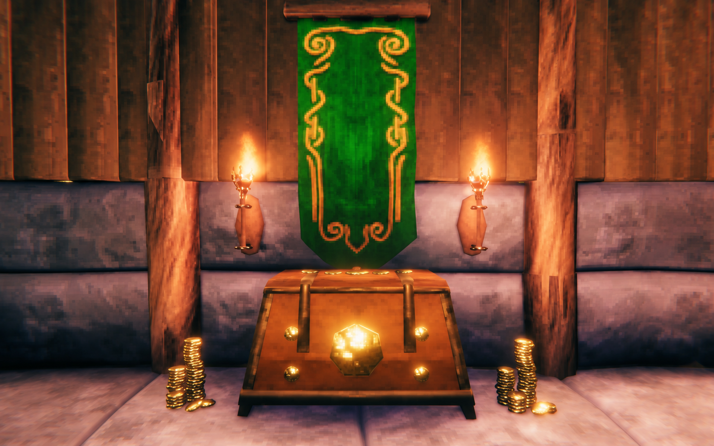
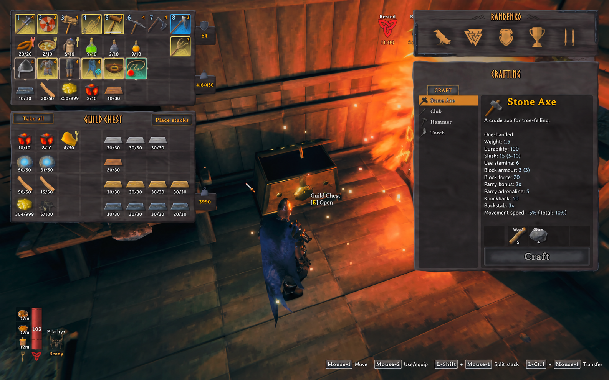
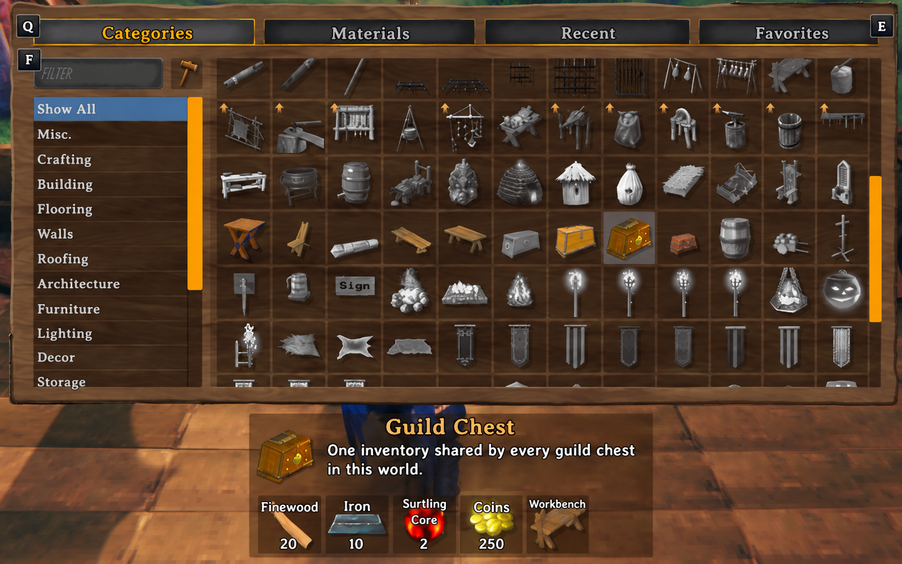
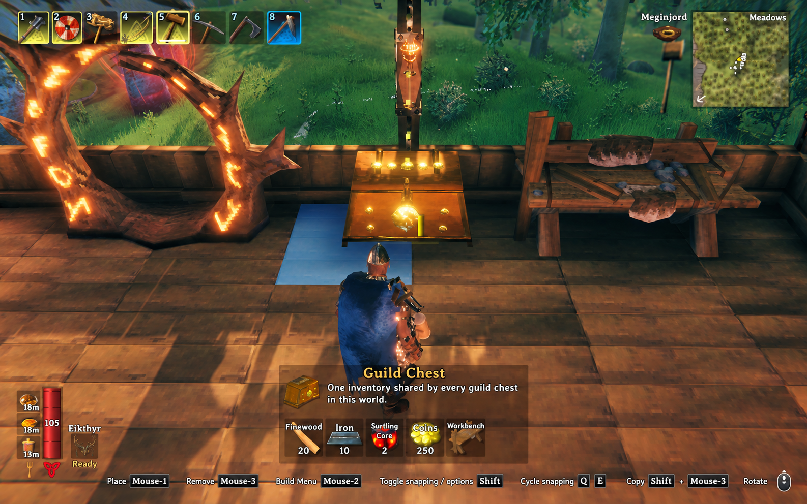

# Guild Chest

**One world. One shared stash.**

Guild Chest adds a gold-decorated chest that connects to one shared **32-slot
inventory** across your Valheim world. Build access points at your main base,
mining camps, and distant outposts to reach the same supplies wherever you adventure.

[](https://www.youtube.com/watch?v=3EhbnWifGQA)

*Watch the [45-second gameplay video](https://www.youtube.com/watch?v=3EhbnWifGQA).*

**Bug reports and feature requests are tracked exclusively through
[GitHub Issues](https://github.com/randenko/valheim-guildchest/issues).**

## Features

- Every Guild Chest accesses the same **32 slots (8 × 4)**, including when other
  access points are far away or unloaded.
- Additional chests add access points, not capacity. Each world has its own stash.
- Metals are accepted. Item quality, durability, crafter information, and custom
  data use Valheim's serialization; stacks merge using vanilla rules.
- One player can access the inventory at a time. Normal ward permissions apply
  at the chest you open. Transfers apply after the host acknowledges them.
- Drag, split, quick-transfer, Take All, and Stack All use the normal inventory
  window. Move items to your player inventory before using or dropping them.
- Contents are saved in the host/server's world save. Destroying any chest
  refunds its construction materials normally and never drops shared contents.
  Destroying the **last chest** keeps the stash saved, including across restarts.
  Rebuild a Guild Chest in that world to access it again.



*One shared inventory, with room for metals and supplies.*

## Build recipe

Use the hammer near a **workbench**. Guild Chest appears immediately after the
reinforced chest in the hammer menu.

| Material | Amount |
| --- | ---: |
| Fine wood | 20 |
| Iron | 10 |
| Surtling cores | 2 |
| Coins | 250 |



*Find the gold chest in the hammer menu; the recipe is shown below it.*



*Add an access point wherever you build.*

## Installation and updates

Install Guild Chest and both required dependencies on **every client and the
host/server**. Use **matching Guild Chest versions** and restart after updates.
For a dedicated server, stop it before replacing files.

- [BepInExPack Valheim 5.4.2351](https://thunderstore.io/c/valheim/p/denikson/BepInExPack_Valheim/)
- [Jötunn 2.30.2](https://thunderstore.io/c/valheim/p/ValheimModding/Jotunn/)

Use a compatible mod manager, or install the dependencies using their manual
instructions and extract the release ZIP's `BepInEx` folder into each Valheim
installation. Both `GuildChest.dll` and `GuildChest.Core.dll` belong together in
`BepInEx/plugins/GuildChest`. Download reviewed builds from
[Thunderstore](https://thunderstore.io/c/valheim/p/Paper_Street_Software/GuildChest/)
or [GitHub Releases](https://github.com/randenko/valheim-guildchest/releases/latest).
Keep item mods installed on the host and all clients when storing their items.

Guild Chest supports solo, player-hosted, and dedicated-server use on PCs with
BepInEx. Console clients cannot load the chest. Recorded native checks use
**Valheim 1.0.16 (Steam build 25527701)**; newer game builds require verification.
Headless checks cover registration, recipes, transfers, and persistence. Live
gameplay was confirmed by the user for launch. See the
[validation record and detailed gameplay scenarios](docs/VALIDATION.md).

## Configuration and optional integrations

After the first launch, configure `BepInEx/config/randenko.GuildChest.cfg`:

```ini
[Compatibility]
Automation range = 20
```

The host enforces this maximum distance in metres for storage-mod transfers and
resource previews (allowed range: 1–100). Configure clients and host consistently;
an integration's own range can restrict it further. Normal chest interaction
keeps its usual range. Capacity and construction costs are fixed.

Optional adapters were tested in the native fixture with **AzuAutoStore 3.1.7**
and **AzuCraftyBoxes 1.8.27**. Neither is required or bundled. AutoStore supports
player hotkey/single-item deposits; CraftyBoxes supports nearby resource previews,
crafting supply, and building after acknowledged transfers. AutoStore ground-drop
automation and CraftyBoxes fuel/ore feeding and Epic Loot consumers exclude guild
storage. Other storage mods need explicit integration. See
[compatibility and limitations](docs/COMPATIBILITY.md).

## Backups, removal, and troubleshooting

Back up the complete world before installing or removing the mod. To remove it,
first withdraw all shared contents into ordinary storage and remove the Guild
Chests while the mod is installed, save, and stop the game/server. Keep a backup
from before removal: loading and saving without the mod can lose its custom
prefabs and shared state. Destroying the last chest alone does **not** empty the
saved stash.

World and character saves remain separate; Guild Chest does not make them one
atomic transaction or protect against edited characters and malicious clients.
Test changes in a disposable world before using a world you intend to keep.

A rejected transfer displays the host's reason and leaves your items untouched.
Check matching versions, ward access, available space, and required item mods;
inspect `BepInEx/LogOutput.log` for details. Include versions, reproduction steps,
and relevant logs in a [bug report](https://github.com/randenko/valheim-guildchest/issues/new?template=bug_report.yml).
Submit [feature requests](https://github.com/randenko/valheim-guildchest/issues/new?template=feature_request.yml)
there too; GitHub Issues is the exclusive tracking channel.

## Support and source

Guild Chest is free and open source under the [MIT license](LICENSE).
Enjoying the mod? [Buy me a coffee](https://ko-fi.com/randenko) as an optional thank-you.

See the [1.1.0 release notes](docs/releases/v1.1.0.md),
[development guide](docs/DEVELOPMENT.md), and [architecture](docs/ARCHITECTURE.md)
for project details.
